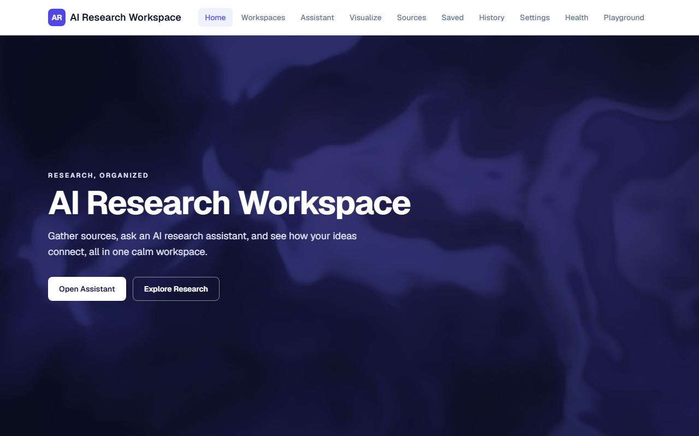
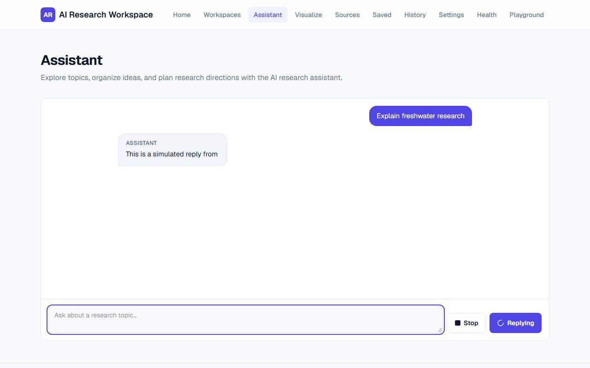
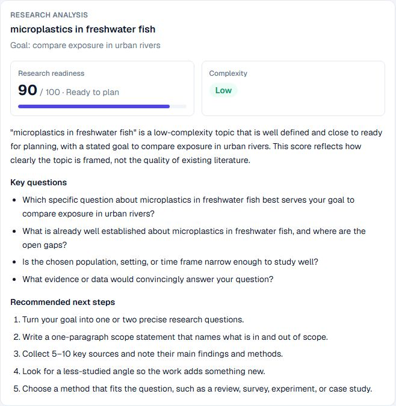
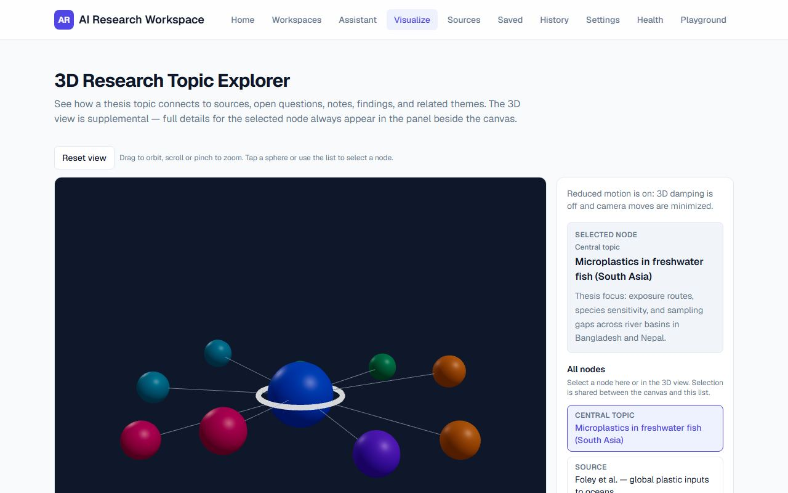

# AI Research Workspace

## Overview

An internship capstone for exploring research ideas with a streaming AI assistant,
structured topic analysis, and an interactive research graph. It combines a Next.js
application with accessibility, motion, WebGL, testing, and production deployment work.

The assistant and visual demonstrations work today. Workspace management, sources,
saved items, history, and settings are navigation scaffolds, not a persistent research
database. Conversations live in memory in the current assistant view.

## Live Demo

**[Open AI Research Workspace](https://ai-research-workspace-three.vercel.app)**

This is the canonical public Vercel domain. Deployment-specific preview URLs may
require Vercel authentication. The live app reflects the last successfully
deployed commit, not uncommitted local changes.

## Screenshots

Images in [docs/screenshots](docs/screenshots/) show the local production test build.
Assistant text is scripted test data; the card uses the real offline tool. These
images do not imply a live model call or a saved user workspace.

| Home shader hero | Streaming assistant |
| --- | --- |
|  |  |

| Structured analysis | 3D topic explorer |
| --- | --- |
|  |  |

## Features

- **Streaming assistant:** server-side OpenRouter/Qwen, multi-turn context, Stop
  with partial-answer preservation, send after Stop, smart auto-scroll, and Jump
  to latest. Model responses are displayed as plain text.
- **Structured analysis:** `analyzeResearchTopic` uses Zod-validated input/output,
  server execution, progress states, and a readable result card.
- **Resilient states:** example prompts, empty-input checks, slow-response skeleton,
  network/mid-stream failures, quota errors, Retry, tool failures, malformed/empty
  results, and route error boundaries.
- **Accessible UI:** manual Modal, Tabs, and Disclosure on `/playground`, with a
  Radix/shadcn comparison in [NOTES.md](NOTES.md). The form is a local demo.
- **Send-button motion:** idle, hover/focus, active, loading, success, and failure
  feedback, reduced-motion support, and duplicate-submit protection.
- **3D Topic Explorer:** a fixed example graph, orbit/zoom, node selection, DOM
  details/list controls, Reset view, and WebGL fallback.
- **Research Signal Field:** custom GLSL fullscreen home hero with subtle motion
  and pointer influence behind semantic text and CTA links.
- **Quality checks:** Vitest/RTL, Playwright across Chromium/Firefox/WebKit,
  GitHub Actions CI, and documented accessibility/performance work.

## Tech Stack

| Layer | Technology |
| --- | --- |
| Application | Next.js 16.4 App Router, React 19.3, TypeScript |
| Styling/UI | Tailwind CSS 4, Lucide, selected Radix/shadcn primitives |
| AI | Vercel AI SDK 7, `@ai-sdk/react`, OpenRouter provider, Zod 4 |
| Model | `qwen/qwen3.8-flash`, configured in `src/lib/ai/config.ts` |
| Graphics | Raw WebGL1/GLSL hero; Three.js, React Three Fiber and Drei on `/visualize` |
| Tests | Vitest 5, React Testing Library, Playwright |
| Deployment | Vercel; GitHub Actions on Node.js 22 |

Exact dependencies are locked in `package-lock.json`; use `npm ci`. OpenRouter
usage is billed to the configured account. Non-chat features work without a key.

## Architecture

```text
Browser: semantic pages + interactive components
  +-- /assistant: useChat + DefaultChatTransport (SSE)
  |     -> POST /api/chat
  |        -> byte cap + burst limiter + envelope/SDK validation
  |        -> server AI config -> OpenRouter / Qwen
  |        -> analyzeResearchTopic (offline deterministic tool)
  |        <- streamed text / typed tool parts -> analysis card
  +-- /: server-rendered hero content + decorative WebGL client canvas
  +-- /visualize: DOM list/details -> optional lazy Three.js scene
  +-- /health: server self-fetch -> GET /api/health
  +-- /playground: accessible component demos
```

| Routes | Purpose |
| --- | --- |
| `/` | Shader hero, assistant/explorer CTAs, workspace navigation |
| `/assistant` | Streaming chat and research analysis |
| `/visualize` | Example research graph and interactive 3D view |
| `/health`, `/api/health` | Server self-fetch check and uncached health JSON |
| `/playground` | Modal, tabs, disclosure and local validation demo |
| `/workspaces`, `/sources`, `/saved`, `/history`, `/settings` | Placeholders for later data features |

AI configuration stays server-side in `src/lib/ai/config.ts`. Tool schemas are
shared with the UI so malformed streamed results are rejected before rendering.
Request admission is separate from provider work and does not buffer outgoing SSE.

### Research analysis tool contract

`analyzeResearchTopic` accepts `topic` (2–200 characters) and an optional
`researchGoal` (up to 300 characters). It returns the topic/goal, an integer
`researchScore` (0–100), `complexity` (`low`, `medium`, `high`), `keyQuestions`,
`recommendedNextSteps`, and `summary`.

Results are deterministic guidance from wording, not a literature search or an
assessment of research quality. The model chooses when to call it. Stopped calls
become cancellation notes in later history; malformed results become tool errors,
so the next turn can still validate.

## Project Structure

```text
src/
  app/                    Pages, API routes, error/loading boundaries
  components/
    assistant/            Chat, Send button, states and analysis card
    home/                 Semantic hero and decorative canvas
    playground/           Accessible form/modal demo
    visualize/            Lazy scene, DOM panel and fallback
    ui/                   Selected Radix/shadcn wrappers
  lib/
    ai/                   Provider, budgets, validation, limiter and tools
    shader/               GLSL, renderer lifecycle and contrast palette
    visualize/            Example graph, motion and WebGL helpers
    testing/              Local-only scripted AI scenarios
  test/                   RTL setup and controllable stream fixtures
e2e/                      Browser compatibility and regression checks
scripts/                  Security scan, production review, screenshot capture
docs/                     Audit, FE-11 review and compressed screenshots
.github/workflows/ci.yml   Verification on pushes and pull requests
```

## Local Setup

Prerequisites: **Node.js 22** (CI's version), npm, Git, and a current browser.
The API uses the Node.js runtime; no database is needed.

```sh
git clone https://github.com/mahamudul-hasan-cse/AI-Research-Workspace.git
cd AI-Research-Workspace
npm ci
cp .env.example .env.local
```

On PowerShell, use `Copy-Item .env.example .env.local` for the last command.
Edit `.env.local`, setting `OPENROUTER_API_KEY` from
[OpenRouter key settings](https://openrouter.ai/settings/keys). Add account credit
and a small provider-side spending limit for a public demo. Never commit the key
or rename it with a `NEXT_PUBLIC_` prefix.

```sh
npm run dev
```

Open [localhost:3000](http://localhost:3000). Restart after changing env variables.
Without a key, pages, hero, graph and playground work; chat returns a designed
503 configuration error.

## Environment Variables

See [.env.example](.env.example) for a template without credentials.

| Variable | Required | Purpose |
| --- | --- | --- |
| `OPENROUTER_API_KEY` | For real chat | Server-only OpenRouter credential; never public. |
| `APP_URL` | Optional | Absolute base URL for `/health` self-fetch. Usually empty; override with the canonical public origin when necessary. |
| `NEXT_PUBLIC_ENABLE_CHAT_SABOTAGE` | No; test-only | `0`/unset normally. Playwright sets `1` at build time. Vercel rejects builds with `1`. |
| `VERCEL` | Automatic on Vercel | Enables trusted platform IP selection and the deployment test-hook guard. Do not set on an untrusted proxy host. |
| `VERCEL_ENV` | Automatic on Vercel | Production/preview health URL selection. |
| `VERCEL_PROJECT_PRODUCTION_URL` | Automatic on Vercel | Preferred production health hostname, without protocol. |
| `VERCEL_URL` | Automatic on Vercel | Preview deployment hostname; may be protected. |
| `VERCEL_AUTOMATION_BYPASS_SECRET` | Optional for protected previews | Server-only Protection Bypass for Automation credential for health self-fetch. Never publish its value. |
| `PORT` | Optional locally | Server/default self-fetch port, default 3000. Match `APP_URL` if using a different `next start -p` port. |
| `NODE_ENV` | Automatic | Set by Next.js or the test runner; do not override for deployment. |
| `CI` | Automatic in CI | Enables strict Playwright checks, one retry and CI reporting. |

Health URL priority: `APP_URL` → production `VERCEL_PROJECT_PRODUCTION_URL` →
`VERCEL_URL` → `http://localhost:PORT`. Avoid a protected deployment-specific URL
for production. `/health` checks the app server, **not** OpenRouter authentication,
credits, model availability or latency.

## Available Scripts

| Command | Purpose |
| --- | --- |
| `npm run dev` | Development server |
| `npm run lint` | ESLint, Next.js and accessibility rules |
| `npm run typecheck` | `next typegen` then `tsc --noEmit`, including on clean checkouts |
| `npm test` | Vitest once |
| `npm run test:watch` | Vitest watch mode |
| `npm run test:coverage` | V8 coverage summary and `coverage/` HTML |
| `npm run test:e2e` | Test production build + three browser engines |
| `npm run build` | Normal optimized production build |
| `npm start` | Serve the latest build |
| `node scripts/security-review.mjs --include-build` | Scan source, reachable history and public build assets without printing credentials |
| `node scripts/review-production.mjs` | Read-only Chromium smoke review of the live app, with chat calls blocked |

## Testing

Install pinned browsers once (`--with-deps` installs required Linux system libraries):

```sh
npx playwright install --with-deps chromium firefox webkit
npm run lint
npm run typecheck
npm test
npm run build
npm run test:e2e
```

Vitest uses RTL/jsdom for components and Node for API admission tests. Coverage
includes streaming, Stop/Retry, tool states, input/rate limits, keyboard behavior,
shader lifecycle and contrast. Unmocked `fetch` fails loudly.

Playwright projects cover **Chromium, Firefox and WebKit**: navigation, desktop/375px
shader, resize, pointer, hidden/offscreen pause, reduced motion, focus, chat streaming,
Stop/continuation, structured tools, Retry, modal interaction and graph selection/reset.
WebKit on Windows/Linux checks the engine; it does **not** replace Safari testing
on macOS or iOS hardware.

The suite uses an isolated sabotage-enabled build and a placeholder key. Chat-flow
tests block unscripted requests. The `tool` scenario scripts model framing but runs
the actual offline analysis. No test needs a real provider credential.

**The e2e command rebuilds `.next` with test hooks on port 3100. Run `npm run build`
again before serving/deploying a normal build. Never upload the test build.**
For local error exploration, `/assistant?sabotage=midstream,mock` simulates failure
then successful Retry. Other modes: `network`, `rate-limit`, `malformed-tool`,
`empty-tool`, `slow`, `tool`, `render`. After the queue is exhausted, later local
sends use the real provider; reload with another queue for further scripted checks.

GitHub Actions runs `npm ci`, lint, type generation/typecheck, Vitest, a normal
production build, then all three Playwright projects on Node 22/Ubuntu. Browsers
are cached and failure reports/traces uploaded. Uncommitted local changes have not
run in hosted CI. Actual checkpoint results are in [docs/FE-11.md](docs/FE-11.md).

## Deployment

1. Import the GitHub repository into Vercel. Select Next.js, repository root,
   Node.js 22, install command `npm ci`, build command `npm run build`, and the
   framework's default output directory.
2. Set server-only `OPENROUTER_API_KEY` under Project Settings → Environment
   Variables for Production (and Preview only if needed). Use a dedicated demo key
   with a provider-side spending limit.
3. Leave `NEXT_PUBLIC_ENABLE_CHAT_SABOTAGE` unset/`0`. Do not set system variables
   yourself. Usually leave `APP_URL` empty; override with the canonical public
   domain if health self-fetch needs it.
4. Deploy `main` with the normal Git integration. Production should be aliased to
   **https://ai-research-workspace-three.vercel.app**. Keep protected per-deployment
   URLs out of public instructions.
5. Check `/`, `/assistant`, `/visualize`, `/health`, `/playground`, `/api/health`
   and runtime logs. Protected previews can use the optional server automation
   bypass secret for health self-fetch.
6. Check provider credits/model access separately for chat failures. Use one short
   real reply/tool call only when necessary; routine compatibility tests are mocked.

Keep [vercel.json](vercel.json): cancellation support lets Stop propagate the
abort signal to the chat function. No paid limiter service is required. Stronger
distributed protection can use a Vercel Firewall rule for `POST /api/chat` or a
shared store, after reviewing availability/costs. Neither is provisioned here.

## Accessibility

- Semantic landmarks, one page `h1`, skip link to `main#main-content`, visible
  keyboard focus, and white hero focus rings over the dark palette.
- Concise chat/tool progress announcements without live-reading each token;
  visible Stop labels on mobile and alerts for errors.
- DOM graph list/details so selection does not require targeting small 3D spheres;
  selection cues use more than color.
- Modal focus entry/restore, Tab containment and Escape; roving tabs; native
  disclosure semantics. See [NOTES.md](NOTES.md) for manual-component limitations.
- Reduced-motion behavior for shader, Send button, 3D controls and transitions.
  Content and controls work through WebGL fallbacks.

Automated smoke/contrast tests are not full assistive-technology certification.
Historical findings and remaining WAVE/device checks are in [AUDIT.md](AUDIT.md).

## Performance

The scene is dynamically imported with `ssr: false`, requested after **Show 3D
view**, then deferred to idle. The DOM panel works independently. It uses small
procedural geometry, precomputed edges and DPR capped at 1.75. Three.js/Drei still
cost roughly 951 KB minified (~280 KB gzip) in the earlier audit; output varies.

The hero uses raw WebGL without Three.js: one triangle, DPR cap 1.5, observer-based
size/visibility, no per-frame React updates, and listener/resource cleanup. Motion
preferences give a static frame. Fonts use `display: swap`.

FE-10 local-production Lighthouse performance was 97 (home), 94 (assistant), 86
(visualize before opening 3D), with accessibility 100. These are historical
measurements **before the shader**, not new FE-11 scores. [AUDIT.md](AUDIT.md)
records the baseline, conditions, comparisons and limits.

## Signature Shader Hero

**Research Signal Field** represents sources and half-formed ideas as a calm flow
with bright contour signals emerging from it. DOM heading, description, **Open
Assistant** and **Explore Research** links sit above an `aria-hidden` WebGL canvas.

| Uniform | Meaning |
| --- | --- |
| `u_time` | Visible animation time; pauses with the loop |
| `u_resolution` | Drawing-buffer dimensions in device pixels |
| `u_mouse` | Eased pointer position in device pixels, bottom-left origin |

Coordinates are centered/divided by the shorter dimension. Rotated fractal value
noise warps a second noise field; sine contours form travelling bands. A Gaussian
pointer lens bends the field and adds glow. Navy/indigo/violet mix with a vignette
and brightness cap; a navy scrim keeps text contrast above 7:1 in palette tests.

The loop pauses on hidden tabs and offscreen heroes. Reduced motion draws one
static frame, ignores pointer input, and redraws on resize. A CSS gradient remains
if WebGL fails. Unmount cancels RAF/observers/listeners and deletes GPU resources;
setup failures also delete partial resources.

Custom code uses common hash/value-noise, FBM and domain-warping techniques
associated with Inigo Quilez's explanations. Contours, pointer lens, palette,
brightness cap and lifecycle are composed for this project; no Shadertoy shader
was copied.

## Security / Production Hygiene

`OPENROUTER_API_KEY` stays in server/provider code, never props or public env vars.
`.env.local` is ignored. The chat route maps errors to safe user messages and logs
those mappings rather than raw provider request details. Plain text rendering
avoids injecting model HTML.

`POST /api/chat` enforces these limits before model work:

| Protection | Limit / behavior |
| --- | --- |
| Body | Valid UTF-8 JSON, JSON content type, at most 256 KiB while reading, even with false/missing Content-Length |
| Messages | 1–50; final message is a nonempty user message |
| Text | 8,000 characters across text/reasoning parts per message |
| Parts | 1–32 supported parts per message; user input is text only |
| Roles/schema | Rejects client system/developer roles, files, remote URLs and unknown parts; SDK validates tool states/input/output |
| Generation | 4,096 output tokens per step; three steps (up to 12,288 output tokens across steps); function max duration 60 s |
| Vercel bursts | 10 configured requests/IP/60-second fixed window **per warm server instance** |
| Other hosts / missing trusted IP | One shared 60-request/minute bucket per instance; arbitrary forwarded headers ignored |
| Limiter memory | At most 5,000 active hashed identities; expires old entries, rejects new identities when full |
| Errors | 400/413/415 for invalid input; 429 with `Retry-After` for bursts; error responses not cached |

Only Vercel's platform-provided `x-vercel-forwarded-for` is trusted when `VERCEL=1`
([header documentation](https://vercel.com/docs/headers/request-headers)). Identities
use an ephemeral HMAC; raw IPs are not logged or returned. Synchronous admission
avoids local check/increment races. Stop/disconnect aborts provider work.

**Limiter boundary:** budgets reset at cold starts and do not synchronize across
instances/regions. This deters trivial repeats; it is neither a global spend cap
nor distributed-abuse protection. Shared networks can share budgets. Use provider
spending limits and consider distributed/platform protection as traffic grows.
Hosting on Vercel alone does not establish a configured chat-specific rate rule.

Normal builds inline sabotage off; Vercel rejects builds that enable it. Run
`node scripts/security-review.mjs --include-build` after a **normal** build to scan
working source, reachable history and public assets for recognizable keys without
printing values. Pattern scans cannot prove absence of all secrets. If a real key
is committed, rotate it first; do not silently rewrite history.

## AI-Assisted Development

AI coding assistants in Cursor/Codex helped plan milestones, scaffold routes,
implement streaming/components/tool states and shader code, debug failures, draft
RTL/Playwright tests, review accessibility, and identify motion/contrast/error
edge cases. Generated work was reviewed against installed framework/SDK behavior,
corrected, and checked through code review, local tests and browser runs.

Specific review/correction examples from the project's development record:

- **shadcn token clash:** generated `--muted`/`--accent` meanings conflicted with
  app theme/text tokens. The tokens were reconciled instead of accepting styling
  that degraded text/focus contrast; see `NOTES.md`.
- **Vercel health self-fetch:** a protected deployment URL redirected to login.
  URL selection now prefers the public production domain, with optional preview
  automation bypass support.
- **Cancelled tool history:** incomplete calls looked unanswered on the next turn.
  Explicit cancellation notes now prevent silently rerunning stopped analysis.
- **Clean-checkout CI:** `tsc` needed generated Next.js types; `typecheck` now runs
  `next typegen` first.
- **Provider reliability:** Gemini was replaced with OpenRouter/Qwen after quota
  issues, with provider configuration and error mapping updated together.
- **Accessibility/performance:** skip link, Stop label, phase announcements, focus,
  contrast and on-demand 3D were reviewed and verified in the audit/browser checks.
- **Shader cleanup:** review found partial WebGL setup objects survived link
  failure; cleanup and a regression test were added before FE-AA3 handoff.
- **FE-11 API review:** existing message/text limits were extended with body-byte
  limits, stricter roles/parts, burst controls and a deployment test-hook guard.

These are concrete reviewed corrections, not a claim that generated code is
automatically correct or that tests replace manual accessibility review.

Manual review and correction focused on generated theme tokens, cancellation and
retry semantics, Vercel URL/environment setup, clean-checkout type generation,
keyboard focus, visible Stop behavior and readable contrast. The audit separates
code/DOM and browser checks from physical-device, screen-reader and WAVE checks
that have not been completed in this checkpoint.

## Audit / Documentation

- [FE-11 production and compatibility review](docs/FE-11.md)
- [Accessibility/performance audit](AUDIT.md)
- [Accessible components and shadcn comparison](NOTES.md)
- [Audit artifact notes](docs/audit/README.md)
- [CI workflow](.github/workflows/ci.yml)

## Limitations

- No authentication, database, saved conversations or cross-device persistence.
  Chat state is in memory; navigation/reload can discard it. Placeholder routes
  do not implement workspace/source CRUD or history.
- Analysis is a wording heuristic. The assistant has no browsing, file access or
  citation retrieval and can still be inaccurate.
- Public chat uses the owner's quota; per-instance throttling is not a global
  spending limit. Long conversations hit message/text/body limits; reload to reset.
- Streams can stop because of provider/function timeouts. The graph uses fixed
  data, and optional 3D has meaningful download/parse cost and GPU dependencies.
- Playwright WebKit is engine coverage, not physical Safari/iOS verification.
  Screen-reader, WAVE and fresh production Lighthouse reviews remain useful.
- Production route smoke checks do not prove provider key/credit/model health;
  mocked tests deliberately avoid provider charges.

## Future Improvements

Authenticated workspaces, persistent conversations, source/citation retrieval,
distributed usage budgets, more browser/device/assistive-technology coverage, and
a lighter or instanced graph for larger real research datasets.

## License

[MIT](LICENSE), copyright 2026 Md. Mahamudul Hasan.
